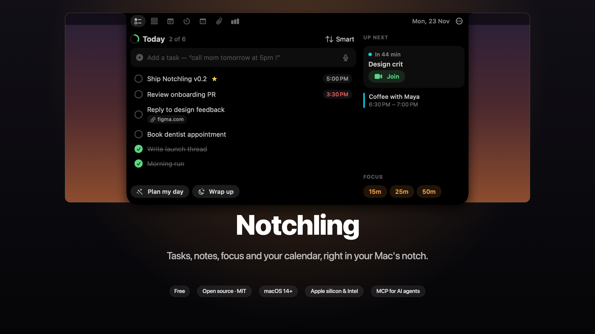
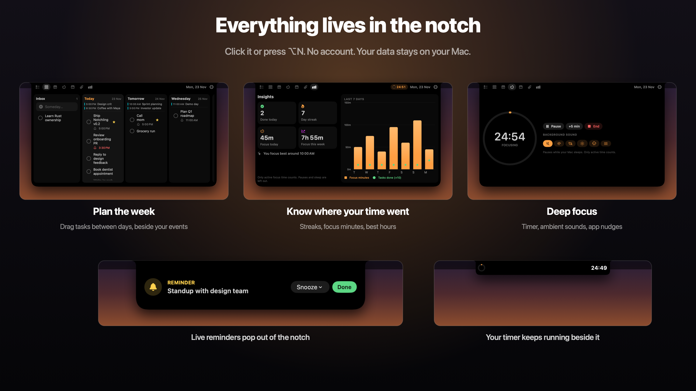
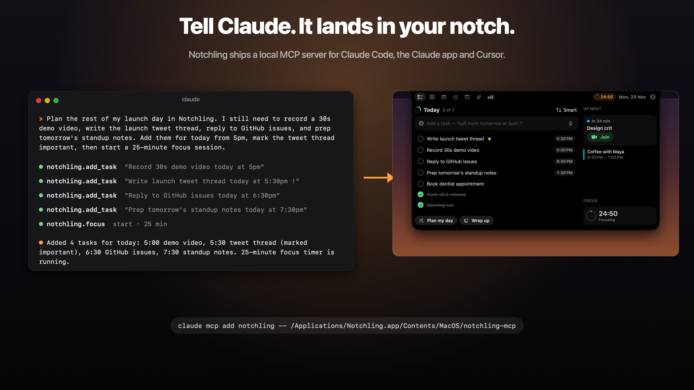

# Notchling

Tasks, notes, focus timers, calendar and clipboard clips in your Mac's notch. Free and open source (MIT).



**[⬇ Download the latest DMG](https://github.com/Arvind-puthucode/notchling/releases/latest)** · macOS 14+ · Apple silicon & Intel

Click the notch or press **⌥N**. Macs without a notch get one drawn at the top center of the screen.

> Notchling is an independent, clean-room project. It is written from scratch from publicly described
> notch-app features, and it shares no code, assets or branding with any commercial notch app.
> Please don't contribute code or assets copied or decompiled from closed-source apps.

## Features

| Area | What it does |
|---|---|
| **Notch** | Opens on click, ⌥N, or hover. Grows slightly under the pointer with a haptic tick. Esc or a click outside closes it. Follows the pointer between displays or pins to one (Settings › Show on). Draws a notch on monitors without one and steps aside for full-screen apps. Dark or light look, adjustable width, height and text size. Optional window mode. |
| **Live activities** | Due reminders, meetings, "time to leave", finished timers and focus nudges open a compact notch with a chime and one-click actions. Click it to expand. Alerts queue. |
| **Today** | Natural-language quick add with a live preview: `call mom tomorrow at 5pm !` sets the day, a 17:00 reminder and the important star. Add by voice (on-device speech). Smart / time / title / newest sort. Double-click to rename. Drop files or links on a task to attach them. Unfinished tasks carry forward. |
| **Plan your day / Wrap up** | Plan fits today's untimed tasks into free time around your events, important first, and gives each a reminder. Wrap up moves leftovers to tomorrow or the Inbox. Offered once a day. |
| **Week** | Inbox plus the next 7 days with your events. Drag tasks between days. |
| **Notes** | Daily notepad with day navigation. Autosaves. **⌘↩** turns the current line into a task. |
| **Focus** | Countdown or stopwatch, pause/resume, +5 min. Pauses while the Mac sleeps. Brown, pink, white, rain and ocean sounds (generated, no audio files). Runs your Shortcuts on start/end. Nudges you back from apps you pick. A live ring and timer sit beside the closed notch. |
| **Calendar** | Read-only Apple Calendar (incl. Google/Outlook accounts), ICS/webcal links, Calendly and Cal.com bookings (keys in Keychain). One-click Join for Zoom/Meet/Teams/Webex. "Time to leave" alerts with Apple Maps travel time. Private camera preview to check yourself before a call. |
| **Apple Reminders** | Optional two-way sync with a "Notchling" list, so tasks reach iPhone and Apple Watch. Newer edit wins; deletes sync both ways. |
| **Clips** | Recent copies, screenshots and screen recordings. Click to copy, drag anywhere, turn into a task. Password-manager items are skipped. |
| **Insights** | Done today, streak, focus today/this week, best focus hour, 7-day chart. Only active focus time counts. |
| **Around the Mac** | Menu bar menu (focus controls, today's tasks, pause reminders for 1 hour). Open tasks searchable in Spotlight. `notchling://` URL scheme for Raycast, Alfred and Shortcuts. Launch at login. |
| **AI agents (MCP)** | Bundled local MCP server for Claude Code, the Claude app and Cursor: list/add/complete/move/delete tasks, set reminders, read/append notes, insights, and start/pause/stop the focus timer. |

All data lives in one JSON file on your Mac: `~/Library/Application Support/Notchling/data.json`. No account. The network is used only for calendar links and booking services you add.



## Character packs

A character can live in your notch: it greets you on Today, cheers when you finish tasks, and delivers reminders in its own voice.
Pick one in **Settings › Appearance › Character**. Built in:

- **Popeye (1929)**: eight poses cut from E. C. Segar's 1929 *Thimble Theatre* strips (Jan 17, Feb 14, Oct 16, Nov 13),
  which are public domain in the US. He rotates poses through the day, flexes for reminders, sits steady during focus,
  and puts his hands on his hips when you finish things. Not affiliated with King Features.

**Make your own** in `~/Library/Application Support/Notchling/Characters/<name>/` (Settings has a button that opens it):

```json
{
  "name": "My Sensei",
  "accent": "#FF9E42",
  "frame": "none",
  "images": { "idle": "idle.png", "happy": "happy.png", "alert": "alert.png" },
  "lines": {
    "greeting": ["{open} missions left today."],
    "empty": ["Nothing on the board."],
    "allDone": ["All {done} done!"],
    "done": ["Mission complete!"],
    "reminder": ["HEADS UP!"],
    "focusStart": ["Training begins."],
    "focusDone": ["TRAINING COMPLETE!"]
  }
}
```

Moods are `idle`, `happy`, `alert` and `focus`; each takes one file or a list to rotate through. Only `idle` is required;
missing moods fall back to it. A `focusing` line list is shown while a focus session runs. Use `"frame": "paper"` for black line art so it reads on the dark notch.
`{open}`, `{done}` and `{total}` are filled in. Packs in this folder stay on your Mac.
Please don't open pull requests with characters you don't have the rights to share; the built-in set is limited to public-domain and original art.

## Install

Download the DMG from [Releases](https://github.com/Arvind-puthucode/notchling/releases/latest), open it, drag **Notchling** to Applications.

The current DMG isn't notarized by Apple yet, so the first launch needs one extra step: right-click Notchling in Applications → **Open** → **Open**
(or run `xattr -dr com.apple.quarantine /Applications/Notchling.app`).

If you launch it straight from the disk image or Downloads, Notchling offers to move itself to Applications and relaunch.

`scripts/build-dmg.sh` signs with a self-signed local identity it creates once in its own keychain
(`~/Library/Keychains/notchling-signing.keychain-db`). The identity stays the same across rebuilds, so macOS
remembers the permissions you granted. Other Macs will still need right-click → **Open** the first time.
For public releases, sign with a Developer ID and notarize (below) so it opens normally everywhere.

Requires macOS 14 or later. Apple silicon and Intel.

## Build

```sh
swift test                  # core logic tests
swift run Notchling         # run in dev (calendar needs the bundled app for its permission prompt)
scripts/build-dmg.sh        # dist/Notchling.app + dist/Notchling-<version>.dmg (universal)
```

Signed + notarized release:

```sh
xcrun notarytool store-credentials notary   # once
SIGN_ID="Developer ID Application: You (TEAMID)" NOTARY_PROFILE=notary VERSION=0.2.0 scripts/build-dmg.sh
```

Set `NOTCHLING_DATA=/path/to/file.json` to point the app or the MCP server at a different data file.

## Connect an AI agent



Claude Code:

```sh
claude mcp add notchling -- /Applications/Notchling.app/Contents/MacOS/notchling-mcp
```

Claude Desktop / Cursor (`mcp.json`):

```json
{ "mcpServers": { "notchling": { "command": "/Applications/Notchling.app/Contents/MacOS/notchling-mcp" } } }
```

Tools: `list_tasks`, `add_task`, `complete_task`, `set_reminder`, `move_task`, `delete_task`, `focus`, `get_note`, `append_note`, `insights`.
The app picks up changes within two seconds. Settings › AI agents can open Terminal and connect Claude Code for you.

## Layout

```
Sources/NotchlingCore    Models, natural-language parser, focus clock, day planner, insights, data file (pure, tested)
Sources/Notchling        The app: notch panel, SwiftUI views, calendar/clipboard/sound services
Sources/notchling-mcp    stdio MCP server over the same data file
Tests/                   XCTest for NotchlingCore
scripts/                 DMG build and icon generator
```

## Roadmap

Desktop widgets (Today, Focus) and Siri / Shortcuts actions need an Xcode project with a widget extension and App Intents;
they're next. Localization is also open. PRs welcome.

## License

MIT. See [LICENSE](LICENSE).
